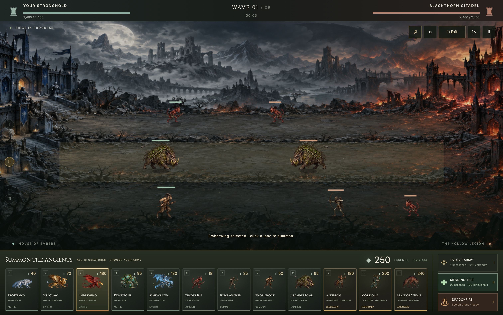

# Emberfall — Dragon Siege

**Command the ancients. Break the siege.**

A dark fantasy strategy game where mythical creatures battle across three lanes. Build a balanced army, defend your stronghold, and bring down Blackthorn Citadel.

[Play the hosted preview](https://emberfall-dragon-siege-vineet.mintycream3.chatgpt.site) · [Development record](ai_logs.md) · [Sound design](AUDIO.md)

The hosted preview uses private ChatGPT access. You can also run the complete game locally without an account or build step.



## The battlefield

- **Twelve creatures, distinct roles.** Field inexpensive minions, durable frontline beasts, ranged specialists, a spirit summoner, and three legendaries.
- **Three lanes to command.** Summon into a chosen lane; creatures march and fight automatically.
- **An economy with tradeoffs.** Essence regenerates over time. Deployment costs, cooldowns, and unit weaknesses make army composition matter.
- **Spells that turn a fight.** Evolve your army, scorch a lane with dragonfire, or heal wounded allies with Mending Tide.
- **Immersive play.** Fullscreen keeps all twelve creature cards visible, with essence and spell controls close at hand.
- **An original soundtrack.** *The Ashen Crown* pairs a medieval battle melody with plucked strings, horns, sustained harmony, and martial drums, alongside creature calls and combat effects.

## Run locally

Requirements: Python 3 and a modern browser. Node.js 18 or later is only needed for the verification and music-rendering scripts.

```sh
git clone https://github.com/vees-1/ember-falls.git
cd ember-falls
python3 -m http.server 4173 --directory dist
```

Open **[http://localhost:4173](http://localhost:4173)**. No dependencies need to be installed.

## How to play

Select a creature in the bottom deck, then click a battlefield lane to summon it. Destroy the enemy citadel before your own fort falls. Use tanks to protect fragile ranged units, and save essence for stronger deployments or spells.

| Control | Action |
| --- | --- |
| `1–9`, `0`, `-`, `=` | Select a creature |
| Up / Down | Choose a lane |
| Enter | Deploy the selected creature |
| Space | Pause or resume |
| `G` / Fullscreen | Enter or leave immersive mode |
| Escape | Close a dialog or leave immersive mode |
| `F` | Cast dragonfire |
| `H` | Cast Mending Tide |
| ♫ / ⚙ | Mute audio / open the mixer |

Immersive mode shows the full roster in one row on wide desktops or two rows on narrower screens. Exiting preserves your battle. If native fullscreen is unavailable, the same layout fills the browser window.

## Build your army

| Creature | Tier | Essence | Role |
| --- | --- | ---: | --- |
| Cinder Imp | Common | 18 | Expendable melee minion |
| Bone Archer | Common | 35 | Fragile long-range support |
| Thornhoof | Common | 50 | Satyr spearman |
| Bramble Boar | Common | 65 | Durable charging beast |
| Frostfang | Mythic | 40 | Swift direwolf |
| Sunclaw | Mythic | 70 | Griffin skirmisher |
| Runestone | Mythic | 95 | Slow golem tank |
| Rimewraith | Mythic | 130 | Ranged wyvern with slowing bolts |
| Emberwing | Mythic | 180 | Dragon with splash damage |
| Asterion | Legendary | 180 | Centaur marksman; exceptional range, modest health |
| Morrigan | Legendary | 200 | Spirit caller; summons up to three living wolves |
| Beast of Gévaudan | Legendary | 240 | Powerful melee ravager with a first-charge bonus |

Summoned wolves grant no kill essence. Each side supports at most 45 living creatures. Legendary cooldowns and vulnerabilities keep cheaper troops useful.

**Mending Tide** costs 90 essence and restores up to 90 health to each wounded ally in the selected lane. It has a 35-second cooldown, cannot overheal or revive, and spends nothing when there are no wounded allies to heal.

## Music and sound

Audio begins when you start the siege. Use the mixer to adjust **master, battle music, ambience, and effects** independently; preferences are saved on your device. Preview the battle theme or individual effects from the audio dialog.

The game includes an original 48-second looping score, a separate environmental sound bed, and 23 procedural cues for dragons, beasts, summoning, magic, healing, weapons, and battle outcomes. Music and ambience fade when paused; the mix is muted in a background tab.

To rebuild the soundtrack from its source score:

```sh
node scripts/render-music.cjs
```

## Verify

```sh
node scripts/smoke-test.cjs
node scripts/audio-test.cjs
node scripts/music-test.cjs
```

These checks cover combat, summoning, economy, cooldowns, healing, battle completion, sound signal quality, and soundtrack reproducibility. Browser checks complement the simulations; audio tests do not replace a subjective listening review.

## Project structure

```text
dist/
  index.html          Battlefield, deck, dialogs, and controls
  style.css           Responsive page and fullscreen presentation
  creatures.js        Creature stats, roles, abilities, and atlas regions
  game.js             Combat simulation, input, effects, and UI
  immersive.js        Fullscreen lifecycle and layout controls
  audio.js            Sound synthesis, playback graph, and mixer
  audio-ui.js         Mixer controls, previews, and audio status
  assets/             Original artwork and rendered battle theme
scripts/
  smoke-test.cjs      Gameplay regression checks
  audio-test.cjs      Procedural audio validation
  music-score.cjs     Original score and instrument synthesis
  render-music.cjs    Reproducible WAV rendering
  music-test.cjs      Composition and rendered-asset validation
```

## Development notes

This is a playable prototype with one battlefield, five escalating wave tiers, twelve selectable creatures, summoned minions, and three army-evolution upgrades. Campaign progression, multiplayer, breeding, persistence, and full frame-by-frame creature animations remain future work. Balance is an initial tuning pass.

See [ai_logs.md](ai_logs.md) for the professional prompt register, release history, decisions, and verification evidence. [agent.md](agent.md) describes the development workflow. Original artwork prompts are recorded in [ASSET-PROMPTS.md](ASSET-PROMPTS.md); music and audio details are in [AUDIO.md](AUDIO.md).
